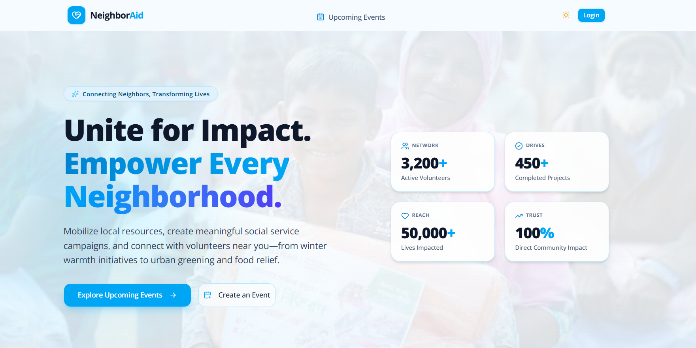

# NeighborAid

A full-stack community service and event-management web platform designed to bridge the gap between volunteers, local organizers, and community support initiatives.

* **Live Site URL**: [https://neighboraid-tau.vercel.app/](https://neighboraid-tau.vercel.app/)

---

## 📸 Application Preview

---

## 🛠️ Technology Stack

* **Frontend**: Next.js (App Router), React, TypeScript, Tailwind CSS,shadcn/ui Component Library, Lucide React, React Toastify
* **Backend**: Node.js, Express.js (REST API architecture handling server-side logic and routing)
* **Database**:MongoDB Atlas (NoSQL Document Store)
* **Authentication**: Better Auth (Secure Session Management, Google OAuth, Email/Password)
* **Deployment & Hosting**: Vercel

---

## 💡 What Problem Does It Solve?
Local community volunteering and charity drives often suffer from fragmentation, poor visibility, and a lack of centralized coordination. Organizers struggle to broadcast their relief campaigns (such as winter clothing drives, food distributions, and cleanups), while eager volunteers miss opportunities to participate due to decentralized communication channels. 

## 🎯 Whose Problem Does It Solve?
* **For Volunteers & Community Members**: Provides a centralized, easy-to-browse hub to discover, track, and join impactful local social work.
* **For Event Organizers & NGOs**: Empowers hosts to seamlessly launch, promote, and oversee community drives with built-in participant management via custom REST endpoints.

---

## ✨ Unique Features & Data Structure
* **RESTful CRUD Operations**: Built robust Express.js backend endpoints executing full Create, Read, Update, and Delete operations for community events and user activity data stored in MongoDB.
* **Localized Event Curation**: Dynamic filtering and categorization of community drives (Donation, Cleanup, Plantation, Winter Relief, Food Drive, Health Camp, Education) tailored for regional social impact across Chattogram.
* **Granular User Dashboards**: Personalized tracking allowing users to monitor events they have created (`/events/create`, `/events/manage`) and community drives they have committed to (`/events/joined`).
* **Secure Authentication & Session State**: Advanced OAuth and credential management via Better Auth ensuring secure role-based navigation and real-time session feedback.
* **Responsive UI & Feedback System**: Fully optimized mobile sheet and desktop navigation with dynamic dark/light mode switching and interactive toast notifications for user actions.

---

## 🧗 Challenges Faced & How They Were Overcome
* **Authentication Provider & Account Linking Conflicts**: 
  * *Challenge*: Encountered `account_not_linked` validation errors when testing dual authentication methods (Google OAuth vs. email credentials) sharing overlapping identifiers. 
  * *Solution*: Implemented strict database schema isolation and session validation rules via Better Auth configuration to ensure seamless account handling and token persistence.
* **Date-Based Filtering & Event Lifecycle Management**: 
  * *Challenge*: Ensuring upcoming events dynamically render based on real-time chronological comparison without hiding active ongoing initiatives.
  * *Solution*: Built robust client-side date utility checks comparing event timestamps against localized date objects to filter active community drives efficiently.